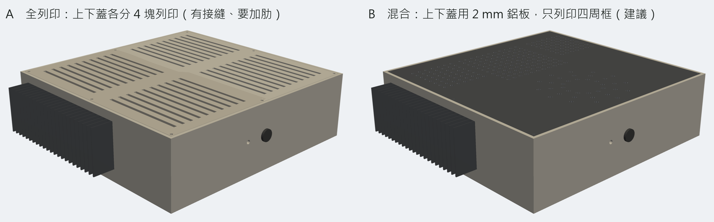
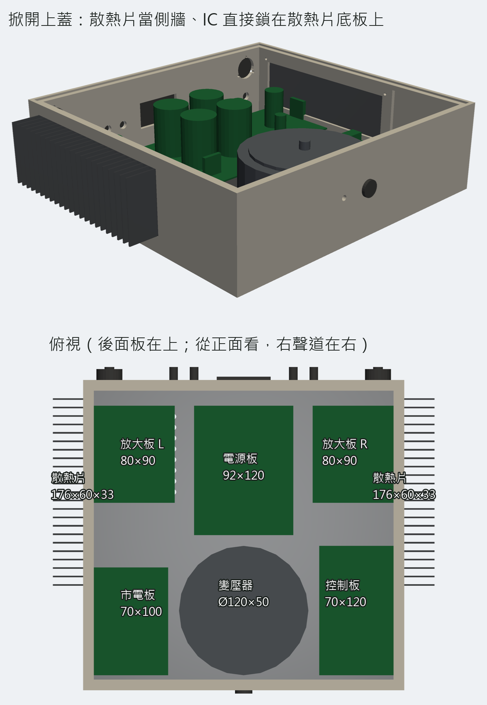
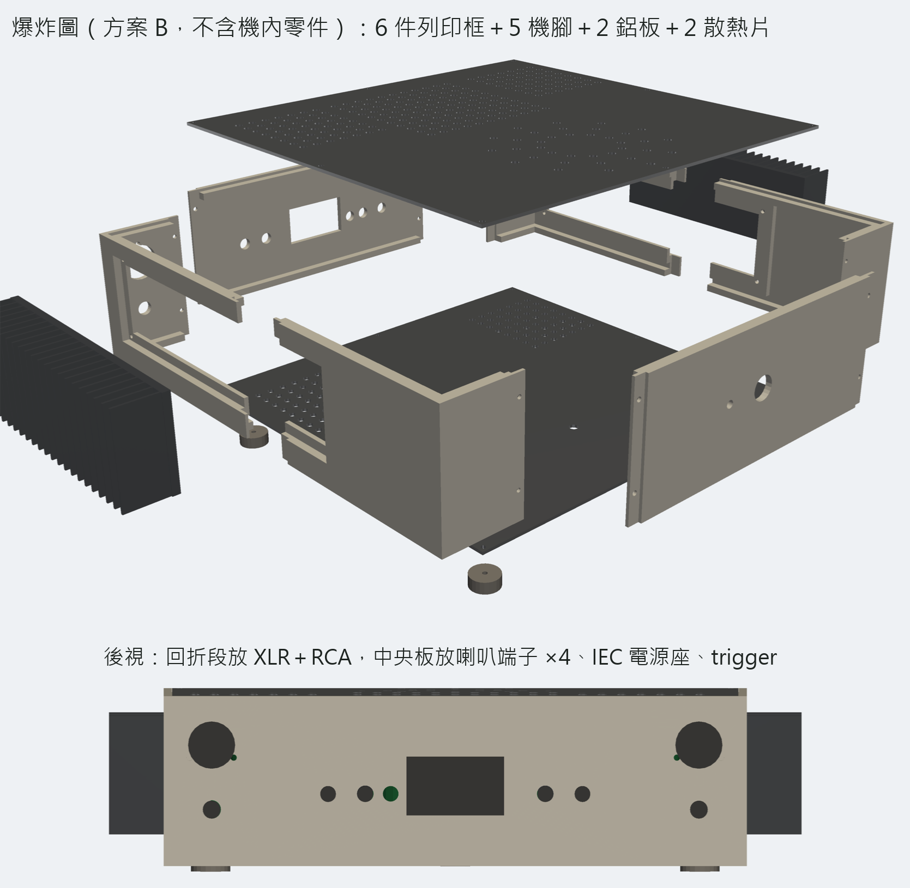

# 3D 列印機殼方案（v0.1，2026-10-25）

> **2026-10-25 已出 v0.2**（Bambu Lab H2D、底殼一體＋上蓋一片、兩片現成板、剛性計算）：見 [16 3D 列印機殼 v0.2](16-3D列印機殼v0.2.md)。本文保留 v0.1 的評估，散熱片熱阻估算仍然適用。

使用者 2026-10-25 買了蝦皮「小白的生活工場」改裝用純鋁陽極黑散熱片 **176×33×60 mm**（$450／片，賣場頁面只標外形，沒標熱阻、底板厚、鰭片數），問能不能用 3D 列印做機殼。本文是第一版評估與模型；**全部是建模與估算，沒有任何實物量測**。模型檔在 `mechanical/chassis-print-v01/`（OpenSCAD 原始檔＋每件 STL），建置腳本 `tools/chassis_print_v01.py`。

## 結論先講

可以做，但要接受三個條件：

1. **散熱片不能關在塑膠殼裡**。塑膠不導熱，散熱片一定要露在機外。本版把兩片散熱片各做成左右側牆的一部分：底板嵌在側牆外側的凹槽裡、鰭片朝外，LM3886 從機內穿過牆上的窗口直接鎖在散熱片底板上（沿用放大板 V0.6「IC 貼板邊」方案 B，放大板不用改）。
2. **機殼太大，一般列印機一次印不完**。三板加變壓器排下來內部至少 290×280 mm，沒有家用列印機放得下一整面；所以拆成 6 件四周框（每件 ≤216 mm）＋上下蓋。上下蓋建議改用 2 mm 鋁板（方案 B），比印 8 塊再拼（方案 A）便宜、平、不翹、順便當接地平面和變壓器底座。
3. **材料不能用 PLA**。散熱片在連續正弦測試時估 60–75 °C，固定它的塑膠唇會一起熱；PLA 55–60 °C 就軟。用 PETG（約 80 °C）勉強、ASA／ABS（約 95–100 °C）比較穩。

另外一條不是列印才有的問題、但塑膠殼會放大：**市電安全與屏蔽**。金屬殼天生是接地的法拉第籠；塑膠殼沒有，所以（a）底板用鋁板並接 PE，散熱片也要接 PE（IC 背板是 VEE，中間隔雲母＋絕緣粒，鎖好要量 OL）；（b）市電板、IEC 座、變壓器一次側全部要有雙重絕緣或蓋罩，塑膠殼裡任何金屬外露件都要接 PE；（c）訊號線走短、遠離變壓器，哼聲可能比鋁殼多，要實測。

## 散熱片夠不夠（估算）

| 項目 | 數值 | 來源／說明 |
|---|---:|---|
| 外形 | 176×60×33 mm | 賣場標示 |
| 鰭片數／底板厚 | 23 片／5 mm | **目測圖片估的**，到貨要量 |
| 表面積 | 約 860 cm² | 23 片×2 面×60×28 ＋ 底板外露面 |
| θSA 估值 | **約 1.2 °C/W** | 專案慣用估法 θSA≈1000／面積(cm²)；鰭片只有 60 mm 高、自然對流煙囪短，實際可能到 1.4–1.6 |
| 每聲道耗散（聽音樂） | 5–10 W | docs/02 模型 |
| 每聲道耗散（8 Ω 連續正弦最壞點） | 約 28 W（±30 V） | docs/02 |
| 正弦時散熱片溫升 | 34–45 °C → 散熱片 60–75 °C | 室溫 25–30 °C；塑膠唇就是這個溫度 |
| 正弦時 Tj | 約 100–110 °C | ＋28×(θJC 1＋θCS 0.3) |

和原本「150×90×30 內置、θSA ≤1.2」的要求同一等級，**8 Ω 可以、6 Ω 連續正弦一樣不行**（docs/02 要 ≤0.65），結論沒變。鰭片一定要直立（60 mm 方向朝上），本版就是這樣放。

## 本版模型





- **座標**：x 向右（從機後看）、y 由後往前、z 向上；原點＝機內右後下角、底板上表面。從正面看 x=0 是右側，所以檔名 `_R` 的件在 x=0 那邊。
- **內部 290×280×78**，牆厚 4，外形 298×288×87（含機腳 95、含鰭片寬 354）。配置沿用弘宙 102 版：後排「放大板 R 80×90｜電源板 92×120｜放大板 L 80×90」、前排變壓器 Ø120 居中、控制板 70×120 左前、市電板 70×100 右前。放大板 IC 面貼牆，IC 背板落在散熱片窗口內（窗口 164×48，IC 20 寬）。
- **四周框 6 件**：左右側框各分前後兩段（在 y=150 半搭接 8 mm，散熱片 176 長剛好跨過接縫、四顆螺絲各鎖兩段，散熱片變成結構件）、側框帶 49 mm 回折段，所以前後中央面板只剩 200 寬、單件可印。輸入端子（XLR 上、RCA 下）放在後回折段，中央後板放喇叭端子 ×4、IEC 電源座（48×28 開孔）、12 V trigger；前板只有電源鈕 Ø16 與 LED。
- **散熱片固定**：牆內側加厚到 8 mm，外側挖 176×60×5 凹槽（深＝底板厚假設值），留 3 mm 厚、6 mm 寬的唇；4 顆 M3 從機內穿過唇鎖進散熱片底板的攻牙孔（**要自己鑽攻，離邊 3 mm**）；塑膠唇只受壓，不受拉。
- **上下蓋**：方案 B 是 2 mm 鋁板 289.4×279.4（放在 5 mm 厚承接唇上、9 顆 M3 熱熔螺母），上蓋打 Ø5 通風孔陣（變壓器、電源板、兩放大板上方）、底板在放大板下打孔、變壓器中心 Ø6.5。鋁板 2 mm 承 2.5 kg 變壓器中央點載估計撓 0.5 mm，所以機腳做 5 顆（4 角＋變壓器正下方）。方案 A 是上下各 4 塊 3 mm 列印板、邊緣半搭接、底板加 4 mm 肋，只在你完全不想碰鋁板時用。
- **列印件清單（方案 B）**：側框後段 162×57×87 ×2（60 cm³）、側框前段 142×57×87 ×2（71 cm³）、後面板 216×87×10（78 cm³）、前面板 216×87×10（83 cm³）、機腳 Ø20×8 ×5；合計約 436 cm³、PETG 約 550 g（100% 實心估，4 mm 牆切片後幾乎就是實心）。每件都 ≤216 mm，220 mm 平台放得下。方案 A 另加 8 塊板約 480 cm³、610 g。

## 還沒確認、下一步

| 要確認 | 為什麼重要 | 怎麼確認 |
|---|---|---|
| 散熱片底板厚、鰭片數、鰭片厚、底板平不平 | 凹槽深度＝底板厚；熱阻估算靠面積 | 到貨量；平整度放玻璃上看縫 |
| 底板能不能鑽攻 M3（厚度 ≥4 才夠 3 牙） | 固定方式全靠這 4 顆 | 量底板厚；不夠就改成兩端用列印夾片扣住鰭片 |
| 買了 1 片還是 2 片 | 模型每聲道 1 片；共用 1 片正弦測試會到 100 °C 以上 | 問使用者 |
| 列印機平台尺寸與材料 | 件的最大邊 216；材料決定耐溫 | **2026-10-25 使用者回：Bambu Lab H2D**。官方規格單噴頭 325×320×325、雙噴頭 300×320×325，熱床 120 °C、腔體主動加熱 65 °C，可印 ASA／ABS。現有每件都放得下；側框前後段可合併成一件 288 長、上下蓋也可整片印（298×288），待使用者決定是否出 v0.2 |
| LM3886T 三個尺寸（HANDOFF 第 1 項） | 決定窗口中心高度與放大板 U1 位置 | 量實物 |
| 塑膠殼的哼聲與 PE 配置 | 沒有金屬殼屏蔽 | 先用方案 B 鋁底板接 PE；組起來量殘餘雜訊 |

模型本身還沒做的：面板搭接處的熱熔螺母孔只畫了一半（側件有、面板對應孔有，但沒畫螺母沉孔）；上下蓋鋁板的鑽孔圖沒出 DXF；機內零件只是外形示意（放大板／電源板用 V0.6 外形與大件位置，不是 KiCad 匯出的真板）。

## 重做方式

```
py -3.13 -X utf8 tools/chassis_print_v01.py            # 匯 STL（約 50 s）→ 算體積 parts.json → 三張圖 → output/ 的 3D 網頁
py -3.13 -X utf8 tools/chassis_print_v01.py --no-export # 只重算圖
```

改尺寸只改 `chassis_print_v01.scad` 開頭的參數（W／D／H／T／RW／SPLIT／散熱片 HS*）。OpenSCAD 2021.01 在 `C:\Program Files\OpenSCAD\openscad.com`，無頭匯 STL 正常（匯 PNG 會 exit 5，所以圖用 pyvista）。
