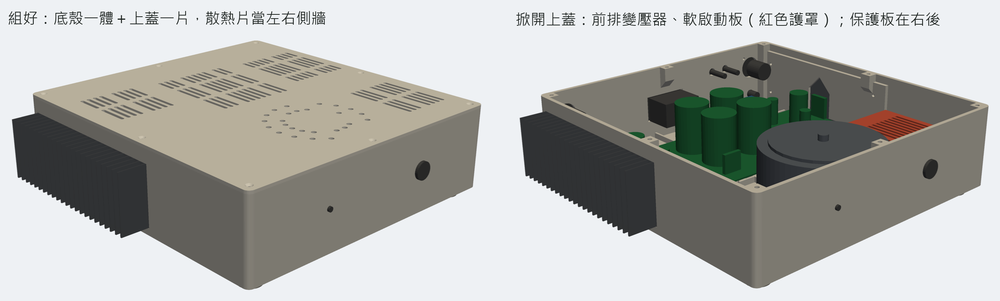
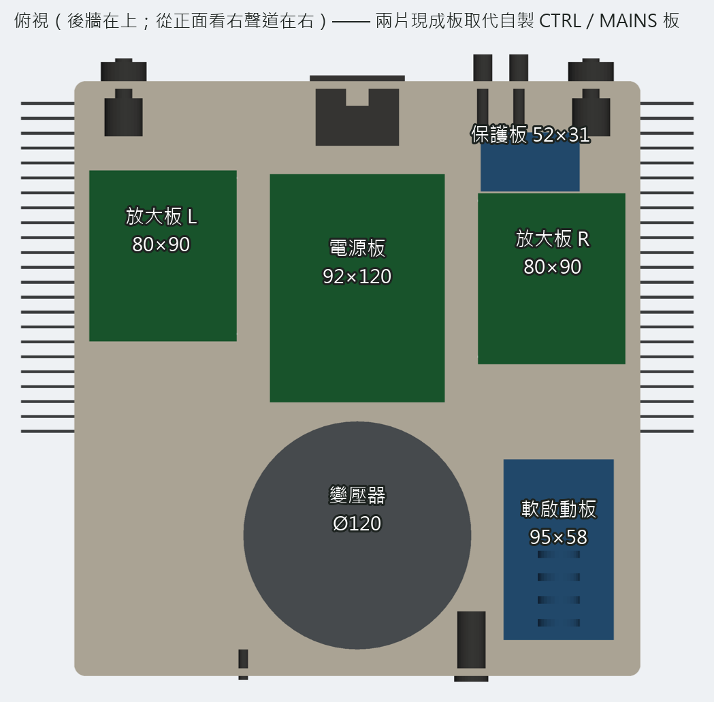
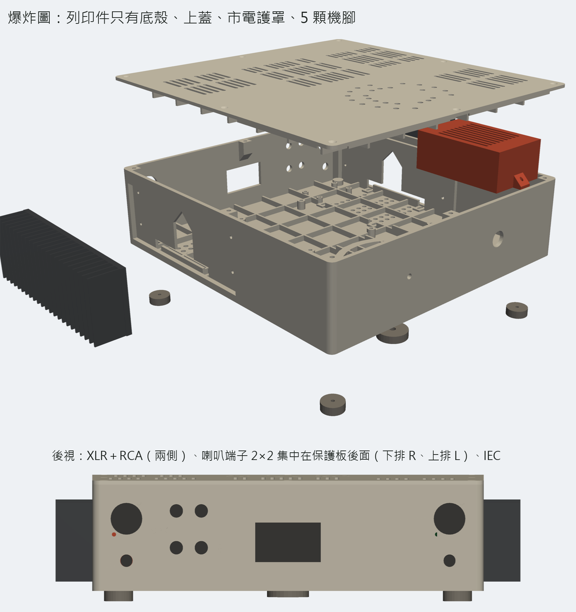
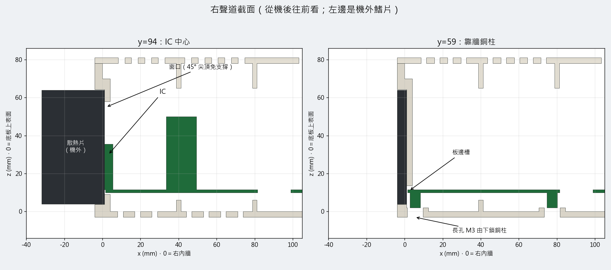
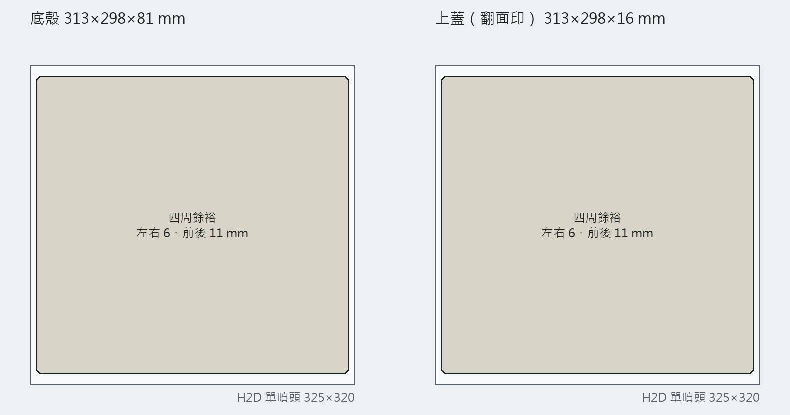

# 3D 列印機殼 v0.2（Bambu Lab H2D，2026-10-25）

使用者 2026-10-25 確認列印機是 **Bambu Lab H2D**，並暫定買兩片現成板取代自製的控制板與市電板（見 [00 採購總表](00-採購總表.md)）。v0.2 依這兩件事重做 [v0.1](15-3D列印機殼方案.md)，並照使用者要求檢查「撐不撐得住整台重量」。

可旋轉的 3D 網頁：https://claude.ai/artifact/G2hRdJRSG9QRTexb23qpk4（私人連結，要分享請從頁面的 Share 選單開）。

**這一版全部是建模與估算，沒有任何實物量測、沒有切片、沒有試印。** 模型在 `mechanical/chassis-print-v02/`，建置腳本 `tools/chassis_print_v02.py`，剛性計算 `tools/chassis_v02_stiffness.py`（格狀梁求解器 `tools/grillage.py`）。

## 結論先講

1. **H2D 印得下，而且只要印 4 種件。** 底殼（底板＋四面牆一體）298×313×81、上蓋 298×313×16，長邊順著 H2D 單噴頭 325 的方向放（官方規格 325×320×325），四周還留 6–11 mm 給 brim。另外是市電護罩 1 件、機腳 5 顆。
2. **剛性夠，但有兩處是算過才加強的。**
   - 底板變壓器那一區的肋從 6 mm 加高到 10 mm。
   - 上蓋肋改成 13 mm 高、40 mm 間距。
   - 改之前，上蓋中央手壓 5 kg 會凹 3.8 mm。改之後是 0.86 mm，在 0.97 mm 的標準以內。
3. **散熱片螺絲不能只墊華司。** 散熱片附近的塑膠長期在 60–75 °C，螺絲壓力集中在小華司下會慢慢壓陷，螺絲就鬆了。要在機內每端墊一條 10×50×1.5 的鋁條，一條蓋住兩顆螺絲。
4. **材料用 ASA。** H2D 有加熱腔體（65 °C），ASA 不容易翹。PLA 不行，PETG 在散熱片旁邊的餘裕太小。



## 和 v0.1 不一樣的地方

| 項目 | v0.1 | v0.2 | 為什麼 |
|---|---|---|---|
| 列印件 | 四周框 6 件＋上下蓋（鋁板或 8 塊列印） | 底殼 1 件＋上蓋 1 件＋護罩＋機腳 | H2D 平台夠大；少接縫、少螺絲，箱體整體剛性高很多 |
| 控制／市電 | 自製 CTRL 70×120、MAINS 70×100 | 現成 UPC1237 保護器 52×31、AC110V 軟啟動板 95×58 | 使用者 10/25 暫定買現成品 |
| IC 窗口 | 164×48 長窗 | 32 寬、45° 尖頂，只開 IC 位置；另開板邊槽讓 PCB 伸到散熱片 | 長窗頂邊是 164 mm 的懸空橋，要支撐；尖頂不用 |
| 放大板位置 | 兩聲道同一 y | 右 y=55、左 y=43，兩顆 IC 都落在散熱片中心 y=94 | 左聲道是同一片 PCB 轉 180°，不是鏡像板，IC 在板上的位置會換邊 |
| 放大板固定 | 示意 | 2 mm 墊＋8 mm 銅柱，底下 M3 長孔可前後調 ±2.5 mm | IC 背板要剛好貼到散熱片底板，PCB 上 IC 的位置還沒用實物核對 |
| 底板 | 鋁板或列印片 | 列印，內側 40 mm 格狀肋（變壓器區 10 mm 高） | 見下面剛性 |
| 變壓器 | 坐在鋁底板 | 坐在承環＋8 條輻肋上，M6 中心螺栓穿過底板直到中央機腳 | 站著放時重量直接走螺栓到機腳，底板幾乎不受力 |
| 內深 | 280 | 305（2026-10-25 使用者選） | 280 時電源座機身和電源板在平面上重疊 10 mm、只靠高度錯開，電源板的直流輸出端子 J203/J204 就壓在它下面，接線沒空間；加深後電源板往前移 25，電源座背後空出 15 mm。比較過「變壓器和電源板互換」：變壓器離兩片放大板各只剩 3.5 mm、直流線要繞 19 cm，沒採用（對照圖 `diagrams/chassis_print_v02_layout_options.png`） |
| 電源開關 | 前面板正中 | 前面板 x=85（從正面看偏右），LED 在對稱位置 | 正中會撞到變壓器（碰撞檢查抓到的） |
| 12 V trigger | 後板有孔 | 先拿掉 | 使用者 10/25 說 trigger 先緩；以後要再鑽 Ø6 |
| 市電 | 無護罩 | 軟啟動板加一個列印護罩（紅色），頂面散熱長孔 | 110 V 裸露在塑膠殼裡；NTC 會熱 |

## 配置



- 座標沿用 v0.1：x 向右（從機後看；從正面看 x=0 是右側），y 由後往前，z 向上，原點是機內右後下角、底板上表面。內部 290×305×78。
- **後排**：放大板 R（x 1.5–81.5）、電源板 92×120（x 99–191、y 45–165）、放大板 L（x 208.5–288.5）。電源座機身到 y=30，和電源板之間空 15 mm。
- **前排**：變壓器 Ø120 在中間（中心 x 145、y 235）；軟啟動板放右前（x 10–68、y 195–290，靠電源開關，市電線最短）。
- **右後（放大板 R 正後方）**：保護板 52×31 平放在 x 28–80、y 23–54。右聲道輸出端子 J2 就在它前面 1 公分多，喇叭端子在它正後方。
- **後牆**：兩側各一組 XLR（Ø24＋兩顆 M3）＋RCA（Ø9.5）；喇叭端子 4 顆集中成 2×2（x 60、79，下排 z 30 是右聲道、上排 z 58 是左聲道，Ø8.5，旁邊刻 R、L、SPK）；中間 IEC C14 含保險絲（47.5×27.5）。
- **前牆**：電源開關 Ø16、LED Ø5。
- **市電路徑**：IEC（後中）→ 前面板開關 → 軟啟動板 → 變壓器一次側。線從放大板 R 和電源板之間的空隙往前走。
- **喇叭線**：右聲道 放大板 → 保護板 → 端子都在右後角，各段只有幾公分。左聲道輸出端子在放大板 L 中段，線從電源板和放大板 L 之間往後、沿後牆內側走到保護板，約 25 公分；保護板出來到端子幾公分。四段合計約 30 公分（原本保護板放左前時約 78 公分）。保護板的 12 Vac 電源線要從前排變壓器拉過來，約 15 公分，細線即可。市電線和左聲道喇叭線各走一個空隙，不擠在一起。



## IC 與散熱片



- 散熱片底板（假設 5 mm 厚）嵌進側牆外側的凹槽，底板內面在 x=1。牆在散熱片範圍加厚到 8 mm，挖 5 mm 凹槽後還剩 3 mm 的唇。
- IC 窗口 32 寬、底 z=9、直邊到 z=42，再往上 45° 收成尖頂到 z=58，直立列印不用支撐。
- 放大板板邊伸進加厚區挖的槽（z 9–13.6），板邊在 x=1.5，離散熱片 0.5 mm。靠牆那排銅柱位置另挖缺口。
- 散熱片用 4 顆 M3 從機內鎖進底板（要自己鑽孔攻牙，離端 10 mm，z=22 和 56）。螺絲頭下面墊鋁條，見剛性第 3 點。
- IC 背板和散熱片之間照原計畫墊雲母＋絕緣粒，鎖好量 IC 背板對散熱片要 OL。散熱片接 PE。

## 剛性與強度

**方法**：底板和上蓋用格狀梁算。肋加上分到的平板當成兩個方向交叉的梁網，牆邊當簡支，這是保守的假設。求解器先用簡支梁和兩端固定梁的公式驗算過，撓度與應力都對得上。其他項目用梁公式算。**這不是有限元素分析。**

**材料與容許值**（[Bambu ASA Technical Data Sheet V2.0](https://cdn.shopify.com/s/files/1/0584/7236/6216/files/Bambu_ASA_Technical_Data_Sheet.pdf?v=1690434954)）：

| 項目 | 數值 | 來源 |
|---|---|---|
| E(XY)、E(Z) | 2450、2120 MPa | 資料表 V2.0 |
| 設計模數 | 1960 MPa | 0.8×E(XY)，扣列印缺陷，假設 |
| 抗拉強度 | XY 37、Z 31 MPa | V2.0 寫 52／35；這裡取舊版與第三方的低值 |
| 熱變形溫度 | 92 °C（1.8 MPa） | 資料表 V2.0 |
| 短時容許應力 | 10.3 MPa | Z 向強度÷3，假設 |
| 長期容許應力 | 4 MPa；散熱片旁熱區 3 MPa | 塑膠潛變，保守假設 |
| 撓度標準 | 長期與壓重 跨距/300；搬運 跨距/150 | 假設 |
| 搬運衝擊係數 | 2 | 假設 |

**重量**（估算，不是量的）：

| 項目 | kg | 依據 |
|---|---:|---|
| 變壓器 | 2.2 | **沒秤過**，200 VA 環形常見值（1.8–2.6） |
| 散熱片 ×2 | 0.60 | 照外形算，底板 5、鰭片 23 片 1.5 厚是估的 |
| 電源板（4×10000 µF/63 V） | 0.40 | 估 |
| 放大板 ×2 | 0.20 | 估 |
| 軟啟動板＋保護板 | 0.17 | 估 |
| 端子、線材、螺絲 | 0.35 | 估 |
| 列印外殼 | 1.26 | STL 體積×1.07 g/cm³，實心估，偏重 |
| **合計** | **約 5.2** | |

**結果**：

| 情況 | 應力／容許（MPa） | 撓度／容許（mm） | 判定 | 說明 |
|---|---|---|---|---|
| 搬運：變壓器重量壓底板（×2） | 4.06 / 10.3 | 1.14 / 2.03 | 過 | 中央機腳離地時變壓器只能靠底板；牆邊固定時 3.8 MPa、0.28 mm |
| 站著放：中央機腳沒碰到地（最壞） | 2.03 / 4.0 | 0.57 / 1.02 | 過 | 正常情況重量走螺栓到中央機腳，底板幾乎不受力 |
| 上蓋放 10 kg（均布） | 4.03 / 10.3 | 0.62 / 0.97 | 過 | 例如疊一台 DAC |
| 上蓋中央手壓 5 kg | 4.80 / 10.3 | 0.86 / 0.97 | 過 | 8 顆螺絲＋定位框實際比簡支硬（固定時 0.30 mm） |
| 兩側抬起，前後牆當梁（×2） | 0.43 / 10.3 | 0.05 / 1.99 | 過 | 箱體本身非常硬 |
| 拿散熱片當把手（×2） | 0.27 / 10.3 | — | 過 | 垂直力壓在凹槽下緣；上排螺絲各受拉約 15 N |
| 散熱片螺絲長期夾緊：Ø7 華司 | 10.2 / 3.0 | — | **不過** | 不要這樣裝 |
| 散熱片螺絲長期夾緊：Ø9 大華司 | 5.5 / 3.0 | — | **不過** | 不要這樣裝 |
| 散熱片螺絲長期夾緊：鋁條 10×50×1.5 | 1.2 / 3.0 | — | 過 | **設計採用** |
| 變壓器螺栓夾緊：底板承環 | 0.39 / 4.0 | — | 過 | M6 手鎖中等，約 1500 N |
| 變壓器螺栓夾緊：中央機腳 | 2.15 / 4.0 | — | 過 | |

**改之前的數字**（同一套算法）：
- 內深 280 時，底板全部 6 mm 肋，搬運撓度 2.07 mm，超過標準。
- 上蓋 6 mm 肋時，中央手壓 5 kg 會凹 3.8 mm，應力 12.0 MPa 也超過。
- 內深 280 時，上蓋 12 mm 肋配 48 mm 間距，手壓凹 1.11 mm；改 40 mm 間距才過。
- 加深到 305 後，12 mm 肋又變成 1.03 mm，所以再加高到 13 mm。肋底 z=65，離電源板電容頂 3.4 mm。

**計算沒涵蓋的**：
- 掉落、運送顛簸。
- 層間剝離：底殼直立列印，牆受彎時層線受拉，所以容許值已經用 Z 向的強度。
- 長期高溫下塑膠整體的潛變：只檢查了螺絲夾緊點。
- 端子插拔時的局部力。

## 列印

| 件 | 數 | 外形 mm | 實心估 g | 擺法 |
|---|---:|---|---:|---|
| 底殼 | 1 | 298×313×81 | 818 | 開口朝上，底面貼平台，長邊順著 325 方向 |
| 上蓋 | 1 | 298×313×16 | 389 | 翻面，外表面貼平台、肋朝上 |
| 市電護罩 | 1 | 64×119×40 | 38 | 翻面，頂面貼平台 |
| 機腳 | 4 | Ø22×8 | 12 | |
| 中央機腳 | 1 | Ø32×8 | 6 | 底面有 M6 螺帽六角槽 |
| **合計** | | | **約 1.26 kg ASA** | 實心估，切片後會少一些 |



- 設計上都免支撐：IC 窗口是尖頂，上蓋螺柱和側螺柱下緣 45°，護罩固定耳有斜撐。孔都是直立牆上的圓孔或 ≤48 mm 的方孔。**實際要在 Bambu Studio 切片確認。**
- 底殼這麼大的 ASA 件，角落最容易翹。建議：
  - 加 brim 5 mm（平台只剩 6–11 mm 餘裕，不要開更大）。
  - 印之前讓腔體先熱。
  - 印完不要馬上開門。
- 列印時間沒有估。要切片才知道，這一件很可能要十幾個小時以上。

## 五金清單（v0.2 需要的）

| 項目 | 數量 | 用在哪 |
|---|---:|---|
| M3 熱熔螺母（孔徑 4.0、深 7） | 26 | 電源板 4、軟啟動板 4、保護板 4、護罩 2、機腳 4、上蓋 8 |
| M3 六角銅柱 8 mm（母母） | 8 | 放大板 |
| M3 螺絲＋華司 | 約 40 | 各處 |
| 鋁條 10×50×1.5 | 4 | 散熱片螺絲壓板，每片散熱片 2 條 |
| 彈簧華司 M3 | 8 | 散熱片螺絲 |
| M6 螺栓（長度到貨量）＋螺帽 | 1 | 變壓器中心，穿底板到中央機腳 |
| 變壓器碟形壓片＋橡膠墊 | 1 組 | 環形變壓器通常附 |
| 機腳止滑墊 | 5 | 機腳底 |

## 電氣安全（塑膠殼要多注意的）

- 塑膠殼不是接地外殼。兩片散熱片各用一個環形端子接到 IEC 的 PE（拿一顆散熱片螺絲鎖）。機外摸得到的金屬就只有散熱片和端子。
- 軟啟動板有 110 V 裸露，一定要裝護罩。IEC 背後的焊點套熱縮套或絕緣套。
- 沒有金屬殼屏蔽，哼聲可能比鋁殼多。輸入線走短、遠離變壓器，組好量殘餘雜訊。

## 還沒確認、下一步

| 要確認 | 影響 | 怎麼確認 |
|---|---|---|
| 變壓器重量 | 剛性計算的最大載重 | 廚房秤 |
| 散熱片底板厚、鰭片數、能否攻 M3 | 凹槽深度、熱阻、固定方式 | 到貨量 |
| 保護板固定孔位置 | 模型暫設離邊 3 mm（參數 `PRIN`） | 到貨量，改 scad 開頭參數 |
| 軟啟動板孔距 84×47 | 商品圖標示的 | 到貨量 |
| LM3886T 背板和 PCB 板邊的關係 | IC 能不能剛好貼到散熱片 | 拿實物乾插；有 ±2.5 mm 長孔可調 |
| 切片後的時間、用料、支撐 | 列印可行性 | Bambu Studio |
| 哼聲 | 塑膠殼沒有屏蔽 | 組好量 |

## 重做方式

```
py -3.13 -X utf8 tools/chassis_print_v02.py            # 匯 STL（約 1.5 分）→ 體積與 H2D 檢查 → 碰撞檢查 → 圖 → 3D 網頁
py -3.13 -X utf8 tools/chassis_print_v02.py --no-export # 只重算
py -3.13 -X utf8 tools/chassis_v02_stiffness.py         # 剛性計算（要先有 parts.json）
```

改尺寸只改 `chassis_print_v02.scad` 開頭的參數。碰撞檢查用 trimesh＋manifold3d（`py -3.13 -m pip install trimesh manifold3d shapely`），結果寫在 `clash.json`，空陣列表示沒有零件互撞。
