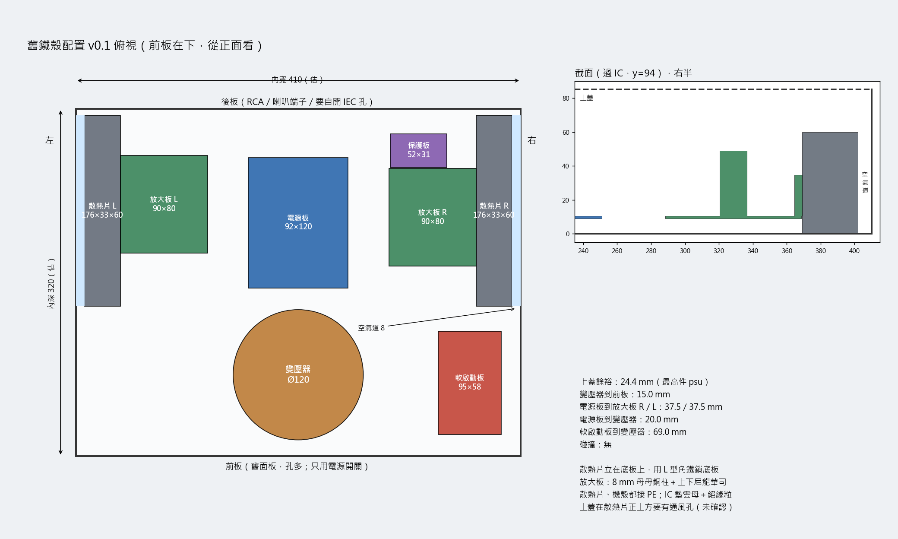
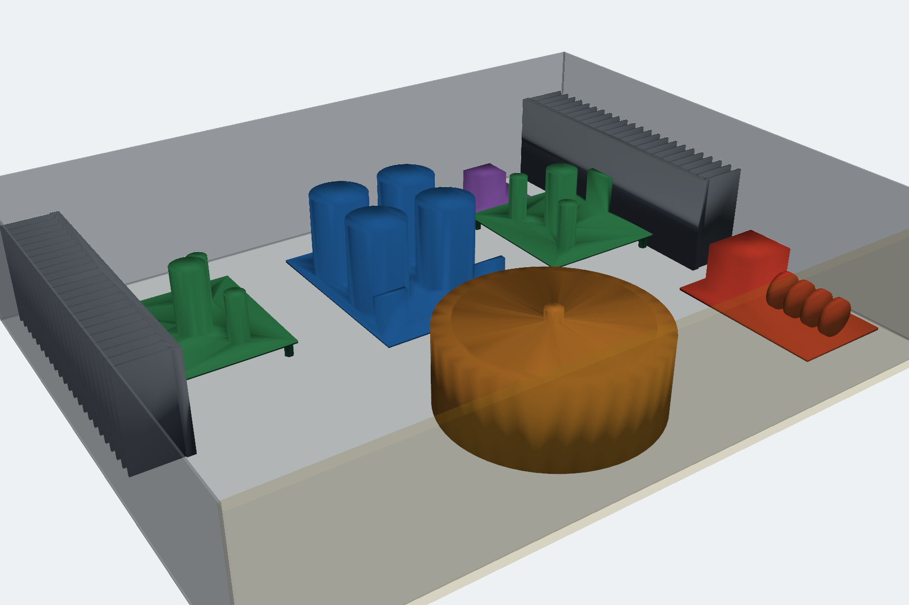

# 舊鐵殼配置 v0.1（2026-11-03）

使用者 10/18 找到的舊擴大機鐵殼（SHENG-LIN），量得外部約 420 寬 × 340 深、內高 85。10/18 決定不沿用舊散熱器，改用已買的 176×33×60 散熱片配 V0.6.1 板。這份是把 3D 列印殼 v0.2 的零件原樣搬進鐵殼的配置，**沒有任何新的實物量測**。

出圖：`py -3.13 -X utf8 tools/chassis_iron_v01.py`（沿用 `mechanical/chassis-print-v02/stl` 的零件模型，只改位置；尺寸報告寫到 `mechanical/chassis-iron-v01/layout.json`）。

## 假設（要量）

| 項目 | 圖上用的值 | 狀態 |
|---|---|---|
| 內寬 | 410 | 由外部 420 估，**未量** |
| 內深 | 320 | 由外部 340 估（前飾板厚未知），**未量** |
| 內高 | 85 | 使用者 10/18 量 |
| 散熱片 | 176×33×60，底板厚 5 | 賣場標示；底板厚未量 |
| 上蓋、底板有沒有通風孔 | 假設上蓋有 | **未確認** |
| 後板現有的孔 | 未知 | 舊機的 RCA／喇叭端子孔能不能直接用，要拍照 |

## 配置

座標同 v0.2：x=0 是從正面看的右側內牆，y=0 是後牆內面，z=0 是底板上表面。

- **散熱片**：放在殼內兩側，立在底板上，用 L 型角鐵鎖底板。鰭片朝側牆、留 8 mm 空氣道，底板朝放大板。散熱片後端離後牆 6。
- **放大板 R／L**：IC 背板貼散熱片底板（墊雲母＋絕緣粒），位置和 v0.2 一樣讓 IC 落在散熱片中心。底下用 **8 mm 母母銅柱，板子上下各墊尼龍華司**，板底離底板 9。
- **電源板**：後排中間，兩側離放大板各 37.5。
- **變壓器**：前排中間，坐 3 mm 橡膠墊；離電源板 20、離前板 15。
- **保護板**：右後，放大板 R 正後方（同 v0.2，喇叭線最短）。
- **軟啟動板**：右前，散熱片 R 前方；離變壓器 69。

## 餘裕（`layout.json`）

- 上蓋：最高件是電源板電容，離上蓋 24 mm。變壓器本體頂 57，加中心螺栓與壓碟約 65–70，仍在 85 內。
- 零件之間無碰撞（包絡盒＋布林交集檢查）。
- 寬度比 v0.2 多 120：放大板與電源板之間有 37.5 的走線空間。

## 和 3D 列印殼 v0.2 不同、要處理的事

1. **固定孔絕緣**：放大板背面整片 GND 鋪銅離固定孔中心 1.85 mm，銅柱壓上去只隔防焊漆。鐵殼接 PE，所以每個固定孔上下要墊尼龍華司（或改尼龍柱）。電源板 H3 離 22 Vac 走線 3.2 mm，同樣要墊。
2. **散熱片在殼內**：熱散在殼裡，上蓋在兩片散熱片正上方要有通風孔、底板最好也有進氣孔。舊機原本散熱片也在殼內（10/18 底面照片），可能已有孔，要確認。
3. **金屬加工**：後板要開 IEC 孔（含保險絲座 47.5×27.5）；RCA、喇叭端子視舊孔位決定；底板鑽散熱片角鐵、銅柱、變壓器中心螺栓孔。
4. **接地**：機殼與兩片散熱片都接 PE（IEC 地線腳 → 機殼接地螺栓，星形華司）。
5. **前板**：舊面板孔多，只用一個當電源開關，其餘封住或貼面板。

## 下一步

- 量內寬、內深、前飾板厚；拍後板與上蓋（看通風孔）。量到後改 `WI`／`DI` 重跑。
- 散熱片到貨量底板厚、決定角鐵形式。

3D 網頁（私人連結）：https://claude.ai/artifact/VachmnGocH5BykvcQD2Fbp，由 `tools/chassis_iron_v01.py` 產生（模板 `mechanical/chassis-iron-v01/viewer_template.html`，輸出在 output/，不入版控）。
